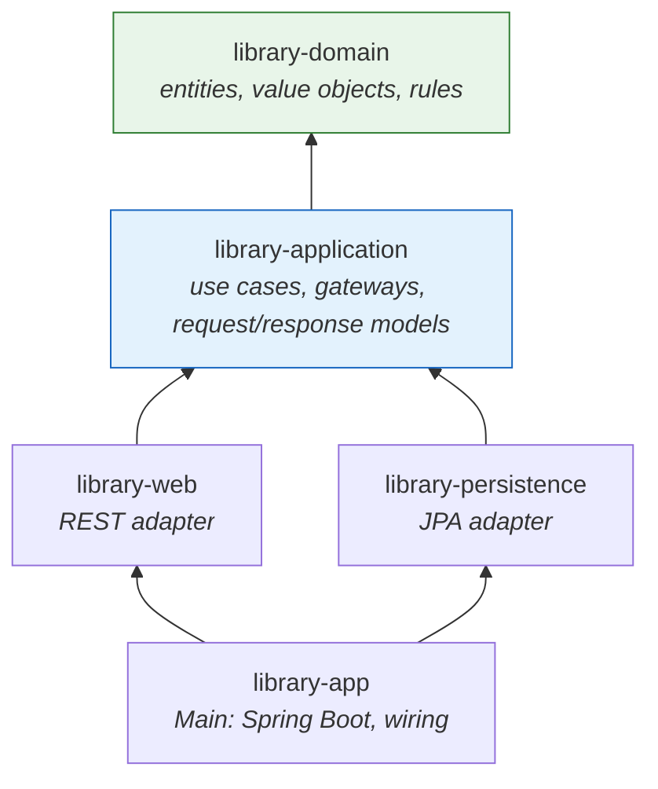

# Clean Architecture, Enforced by the Build

[](https://github.com/alef2509/clean-architecture-multimodule/actions/workflows/ci.yml)


A library lending system (loans, renewals, fines, reservations, holds) built with
**Clean Architecture**, where the dependency rule is not a convention but a property
of the build: each ring is a Maven module, and the core cannot even *see* a framework.



Arrows are Maven dependencies. `library-domain` and `library-application` are plain Java,
with no Spring, JPA or Jackson on their classpath, and the **maven-enforcer** rule
fails the build if one ever sneaks in:

```
$ ./mvnw validate   # after adding spring-context to library-domain
[ERROR] Rule 0: BannedDependencies failed with message:
[ERROR] The core must not depend on frameworks: keep them in the adapters.
[ERROR]    org.springframework:spring-context:jar:6.2.19 <--- banned via the exclude/include list
```

## Compared with the hexagonal project

Both projects keep business rules away from frameworks; they show two ways to get there.

| | [Hexagonal banking API](https://github.com/alef2509/hexagonal-architecture-banking-api) | This project |
|---|---|---|
| Rule enforced by | ArchUnit tests | **Maven module graph + enforcer** |
| Structure | One module, packages | Five modules, one per ring |
| Use case API | Ports returning domain objects | **Input boundaries with Request/Response models** |
| Transactions | AOP proxy in the composition root | **`UnitOfWork` port**, implemented by the JPA adapter |
| Use case tests | Hand-written fakes | **In-memory gateways shared as a test-jar** |

## The domain

| Rule | Where |
|---|---|
| Valid ISBN-13 (checksum) | `Isbn` value object |
| STANDARD members may hold 3 books, PREMIUM 10 | `Member.Membership` |
| No new loans while any loan is overdue | `BorrowCopyInteractor` |
| 14-day loans, one renewal, not when overdue or when someone is waiting | `Loan`, `LoanPolicy` |
| Fine of 0.50 per day late, capped at 20.00 | `Loan.returnOn` |
| Reservations only when no copy is available; first come, first served | `ReserveBookInteractor` |
| A returned copy goes **on hold** for the next member in the queue for 3 days | `ReturnCopyInteractor`, `Copy` |
| One active loan per copy, even under concurrent requests | partial unique index + optimistic locking → `409` |

## API

| Method | Path | Use case |
|---|---|---|
| `POST` | `/api/v1/books` | RegisterBook (with N copies) |
| `POST` | `/api/v1/members` | RegisterMember |
| `POST` | `/api/v1/loans` | BorrowCopy |
| `POST` | `/api/v1/loans/{id}/renew` | RenewLoan |
| `POST` | `/api/v1/loans/{id}/return` | ReturnCopy (fine, hold) |
| `POST` | `/api/v1/reservations` | ReserveBook |
| `GET` | `/api/v1/members/{id}/loans` | ListMemberLoans |

Rule violations are RFC 9457 problems: `urn:problem-type:library:loan-limit`, `book-reserved`,
`has-overdue-loans`, `copy-unavailable`, `conflict`...

```bash
docker compose up --build        # or: ./mvnw -pl library-app spring-boot:test-run
```

## Testing

```bash
./mvnw verify
```

| Module | Tests | Speed |
|---|---|---|
| `library-domain` | ISBN, due dates, fines, renewals, holds | milliseconds |
| `library-application` | every use case against **in-memory gateways** and a movable clock ("15 days later...") | milliseconds |
| `library-web` | HTTP contract with use cases mocked at their boundaries | seconds |
| `library-app` | the assembled system on PostgreSQL (Testcontainers): full reservation/hold flow, limits, **4 members racing for one copy → exactly one loan** | seconds |

## Architecture decision

- [The dependency rule is enforced by the build, not by convention](docs/adr/0001-dependency-rule-enforced-by-the-build.md)

## Tech stack

Java 21 · Maven multi-module · maven-enforcer · Spring Boot 3.5 (adapters and main only) ·
Spring Data JPA · PostgreSQL 17 · Flyway · JUnit 5 · AssertJ · Mockito · Testcontainers ·
Docker · GitHub Actions

## License

[MIT](LICENSE)
